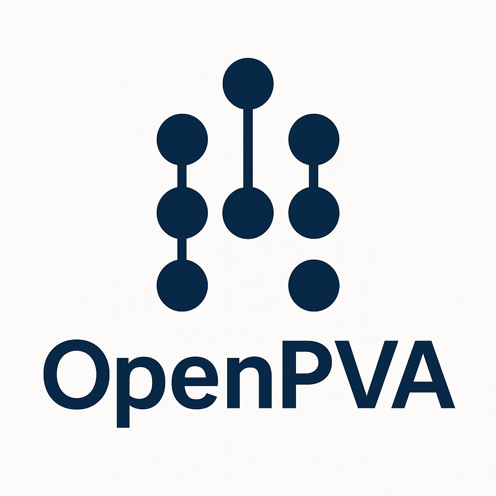

# OpenPVA  
**An Open, Modular Framework for Population Viability Analysis**



[](docs/roadmap.md)  
[](LICENSE)  
[](https://cran.r-project.org/)  
[](docs/workflow.md)  
[](LICENSE)

---

## Overview

**OpenPVA** is a next-generation, open-source platform for conducting **Population Viability Analysis (PVA)**—the simulation and analysis of population dynamics, extinction risk, and management outcomes for structured biological populations.  

Inspired by the early vision of the original GAPPS (Generalized Animal Population Projection System), OpenPVA reimagines that philosophy with modern software architecture: fully **modular**, **extensible**, and **transparent**. It is designed for ecologists, conservation biologists, and decision scientists who need a flexible but rigorous tool to simulate population trajectories under a range of biological, genetic, environmental, and management scenarios.

OpenPVA is being developed as a long-lived, community-maintained framework rather than a one-off species model.

---

## Key Features

- Individual-based demographic engine with age/sex structure.
- Optional density feedback (ceiling K) and quota-based harvest.
- Optional mating constraints via `require_mate` and `make_mate_limited_mating_fun()`.
- Replicated simulations with extinction metrics and mean trajectories.
- Spatial summaries including patch occupancy and patch-level genetic diversity.
- Lifecycle pipeline control via `lifecycle_steps` for custom sequencing.
- Scenario API (`scenario_spec()` / `run_scenario()`) with optional YAML loader (`read_scenario_yaml()`).

---

## Project Status and Roadmap

OpenPVA is under **active development**.

Current phase: **Phase 1 – Core Demographic Engine**  
(see `docs/vision_and_scope.md` and `docs/roadmap.md`)

Phase 1 focuses on the core demographic engine, density feedback, harvest, replicates, and scenario/YAML tooling. Genetics, spatial structure, decision-support tooling, and GUIs remain roadmap items for later phases.

---

## Repository Layout

Key top-level elements:

- `R/` – Core R code: individual/population representations, lifecycle modules, controllers.
- `_targets.R` – `targets` pipeline definition for running simulations and analyses.
- `bootstrap_env.R` – Environment bootstrap using `renv`.
- `scripts/build_release_evidence.sh` – Non-publishing release evidence automation.
- `tests/` – Unit tests (`testthat`).
- `docs/` – Design and governance docs for architecture, conventions, scope, and agent behaviour.
- `quarto/` – Quarto sources for the documentation site (rendered into `docs/` as needed).
- `inst/extdata/` – Packaged example inputs (e.g. demo YAML scenarios).
- `outputs/` – Generated outputs (via targets, not ad hoc scripts).

For a map of the internal documentation, see `docs/docs_index.md`.
For the current exported surface, see `docs/reference/public_api.md`.
For density-channel configuration details, see `docs/reference/density_api.md`.
For CI profile split and local reproducibility commands, see `docs/reference/ci_profiles.md`.
For release-evidence automation, see `docs/reference/release_automation.md`.

---

## Getting Started (Developers)

### 1. Clone and initialise the environment

```bash
git clone https://github.com/BWBrook/OpenPVA.git
cd OpenPVA
Rscript bootstrap_env.R   # restores renv and installs missing Suggests used in dev/CI
```

Alternatively, in an R session:

```r
renv::restore()
```

### 2. Run the pipeline

Once the environment is ready:

```bash
Rscript -e "targets::tar_make()"
```

This will run the workflow defined in `_targets.R`, using the lifecycle modules in `R/`.

### 3. Run tests

Before pushing changes:

```bash
Rscript scripts/run_tests.R
```

### 4. Run a minimal scenario in R

```r
pkgload::load_all(quiet = TRUE)

sc <- OpenPVA::scenario_spec(
  name = "readme_demo_r",
  n_runs = 5,
  n_years = 20,
  init_fun = function() OpenPVA::initialize_population(50),
  density_spec = OpenPVA::density_spec(
    survival_fun = OpenPVA::make_ceiling_density_fun(K = 80)
  ),
  harvest_quota = 2,
  seed = 20260208L
)

res <- OpenPVA::run_scenario(sc)
OpenPVA::summarise_extinction(res$sim_output)
```

### 5. Run the same style scenario from YAML

```r
yaml_path <- file.path("inst", "extdata", "demo_density_harvest.yaml")
sc_yaml <- OpenPVA::read_scenario_yaml(yaml_path)
res_yaml <- OpenPVA::run_scenario(sc_yaml)
OpenPVA::summarise_extinction(res_yaml$sim_output)
```

---

## Coding Conventions (Summary)

Full details are in `docs/dev_conventions_r.md`. In brief:

* Use `snake_case` for functions and objects.
* Do **not** call `library()` or `require()` in package code or `_targets.R`.
* Use `package::function()` for all non-base functions.
* Keep lifecycle modules **pure**: no file IO, plotting, or global state changes.
* Document exported functions with Roxygen.
* Add tests for new behaviour under `tests/testthat/`.

---

## Design Heritage

OpenPVA draws heavily on the ideas in **GAPPS** (Generalized Animal Population Projection System):

* Scripted, modular lifecycle processes.
* Explicit stochasticity and density dependence.
* Integration of demography, genetics, and management.

For a concise summary of that heritage and what we are (and are not) copying forward, see `docs/gapps_heritage.md`.

---

## Contributing

OpenPVA is intended to be a **community platform**. Contributions may include:

* New demographic, genetic, spatial, or management modules.
* Improvements to the simulation controller or pipeline patterns.
* Documentation, teaching examples, and vignettes.
* Testing, validation, and benchmarking against classic PVAs.

Before contributing, please read:

* `docs/dev_conventions_r.md`
* `docs/vision_and_scope.md`
* `docs/roadmap.md`
* `AGENTS.md` (if you are using an embedded agent)

Pull requests should describe:

* Which modules/files are affected.
* What tests you ran (`Rscript scripts/run_tests.R`, `targets::tar_make()`).

The default `_targets.R` demo workload is intentionally smoke-sized for fresh
checkouts and laptops:

- `sim_basic_reps`: `20` runs x `30` years
- `sim_basic_dense_harvest`: `15` runs x `30` years
- `spatial_scenario_two_patch`: `5` runs x `20` years

Heavier ensembles should be run explicitly in scenario or release-evidence
workflows rather than assumed by the baseline demo pipeline.
* Any changes to dependencies (`bootstrap_env.R`, `DESCRIPTION`).

---

## License

OpenPVA will be released under the **MIT License**, ensuring open use, modification, and distribution.

---

## Citation

A formal software paper is forthcoming. For now, please cite as:

> Brook, B. W. et al. (in prep). *OpenPVA: An open, modular platform for population viability analysis*.

---

## Contact

Lead developer: **Barry W. Brook**  
Email: [barry.brook@utas.edu.au](mailto:barry.brook@utas.edu.au)

---

## Quick start: run the basic example

```bash
Rscript -e "targets::tar_make()"
```

Inspect selected targets inside R using `targets::tar_read()`:

```r
# Extinction summaries and trajectories
targets::tar_read(sim_basic_reps_extinction_summary)
targets::tar_read(sim_basic_dense_harvest_extinction_summary)
traj <- targets::tar_read(sim_basic_dense_harvest_trajectory)
head(traj)

# File path for the mean trajectory plot
plot_path <- targets::tar_read(sim_basic_dense_harvest_trajectory_plot)
plot_path
```

## Scenarios and YAML

Define scenarios directly in R:

```r
breed_prob_tbl <- data.frame(
  age_min = c(0, 3),
  age_max = c(2, Inf),
  sex = c("F", "F"),
  p_breed = c(0, 0.65)
)
lambda_tbl <- data.frame(
  age_min = c(0, 3),
  age_max = c(2, Inf),
  sex = c("F", "F"),
  lambda = c(0, 1.4)
)

sc <- OpenPVA::scenario_spec(
  name = "demo_repro_rates",
  n_runs = 10,
  n_years = 20,
  init_fun = function() OpenPVA::initialize_population(80),
  survival_fun = OpenPVA::default_survival_fun,
  breeding_prob_fun = OpenPVA::build_breeding_prob_fun_from_table(breed_prob_tbl),
  fecundity_lambda_fun = OpenPVA::build_fecundity_lambda_fun_from_table(lambda_tbl),
  env_repro_p_sd = 0.15,
  env_repro_lambda_sd = 0.10,
  cat_repro_prob = 0.10,
  cat_repro_mult = 0.50,
  density_spec = OpenPVA::density_spec(
    survival_fun = OpenPVA::make_ceiling_density_fun(K = 60)
  ),
  harvest_quota = 2,
  seed = 20260208L
)

res <- OpenPVA::run_scenario(sc)
OpenPVA::summarise_extinction(res$sim_output)
head(res$sim_output$summary[, c(
  "year", "n_births",
  "env_repro_p_mult", "env_repro_lambda_mult",
  "cat_repro_mult", "repro_catastrophe"
)])
```

Load scenarios from canonical schema v3 YAML:

```r
yaml_path <- file.path("inst", "extdata", "demo_reproduction_v2.yaml")
sc_yaml <- OpenPVA::read_scenario_yaml(yaml_path)
attr(sc_yaml, "yaml_schema_version")
```

YAML is a convenience for sharing scenarios; all functionality is accessible directly from R.
You can set `seed` in either `scenario_spec()` or YAML to make replicated outputs deterministic.

## Reproduction semantics and YAML schema

How do I specify breeding and fecundity now?

- Preferred channels are baseline rates:
  - `breeding_prob_fun` (`p_breed` in `[0, 1]`)
  - `fecundity_lambda_fun` (`lambda >= 0`)
- Table builders:
  - `build_breeding_prob_fun_from_table()`
  - `build_fecundity_lambda_fun_from_table()`

How do reproduction EV/cats work?

- Reproduction EV/cat is applied in the controller before stochastic draws.
- In R scenarios, use:
  - `env_repro_p_sd`
  - `env_repro_lambda_sd`
  - `cat_repro_prob`
  - `cat_repro_mult`
- In YAML schema v3, use the `reproduction_ev` block with the same key names.
- Summary outputs expose realized year-level reproduction diagnostics:
  - `env_repro_p_mult`
  - `env_repro_lambda_mult`
  - `cat_repro_mult`
  - `repro_catastrophe`

What YAML shape is supported?

- `schema_version: 3` is required.
- Use canonical demography keys:
  - `demography.survival.table`
  - `demography.breeding_prob.table`
  - `demography.fecundity_lambda.table`
- Use `density` for density configuration and `management` for harvest and supplementation.
- Older YAML shapes are intentionally not supported in this development line.

## Reproducibility and RNG seeding

- Set `seed` in `scenario_spec()` or YAML to make `run_scenario()` deterministic.
- Set `seed` in `run_basic_simulation_replicates()` for deterministic replicated runs without using scenarios.
- The seed controls stochastic demographic realization and year-level EV/cat draws.
- OpenPVA restores caller RNG state after a seeded replicate/scenario run, so downstream RNG streams are not perturbed.

## Decision-support summaries

For management comparisons, OpenPVA provides additive summary helpers:

- `summarise_extinction()`
- `summarise_harvest_yield()`
- `summarise_final_abundance()`
- `compare_scenarios()`

Example:

```r
res <- OpenPVA::run_scenario(sc)
OpenPVA::summarise_final_abundance(res$sim_output, floor = 25)

comparison <- OpenPVA::compare_scenarios(
  list(current = sc, alternative = sc_density_v2),
  extinction_threshold = 10,
  final_n_floor = 25
)
comparison[, c(
  "scenario_name", "p_extinction", "mean_total_harvest",
  "mean_final_n_alive", "p_final_below_floor"
)]
```
